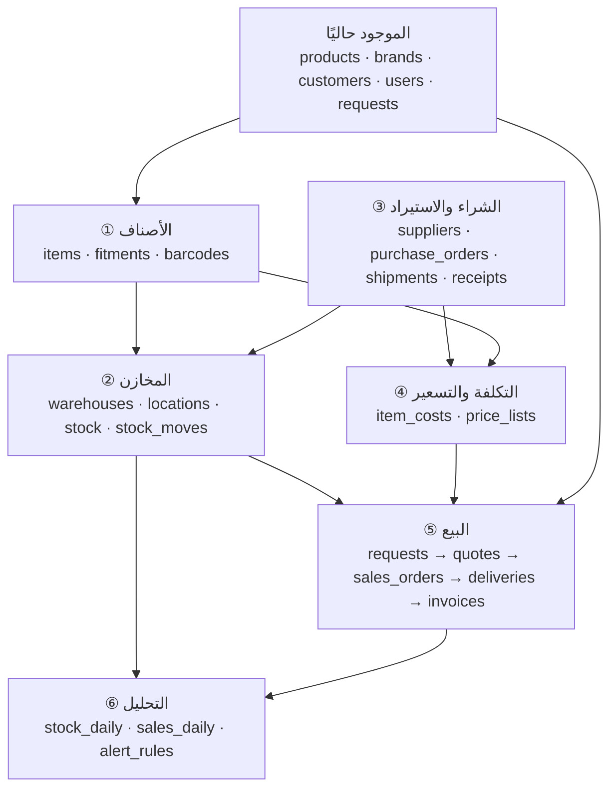
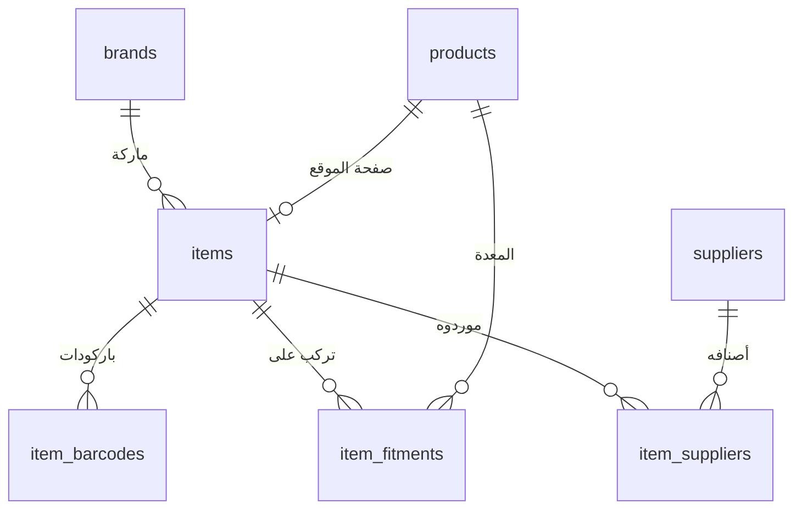
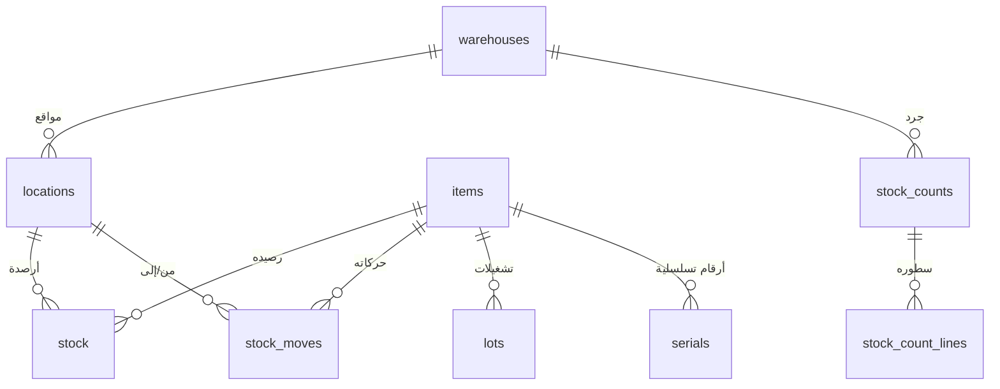
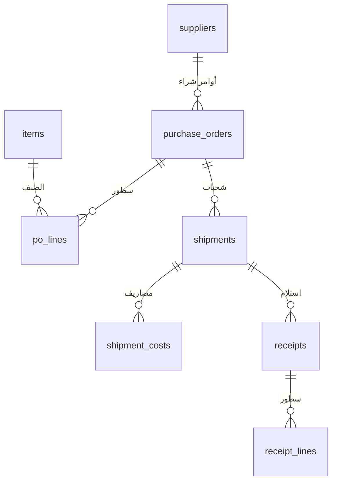
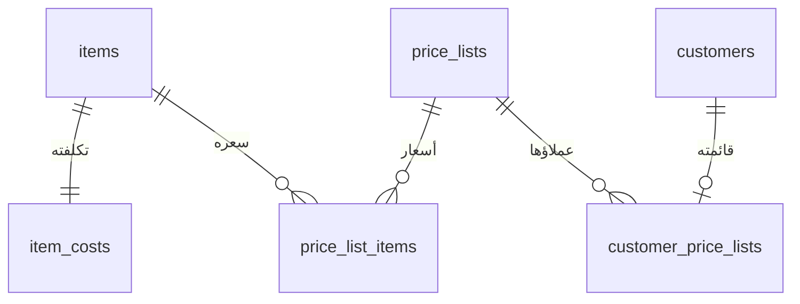
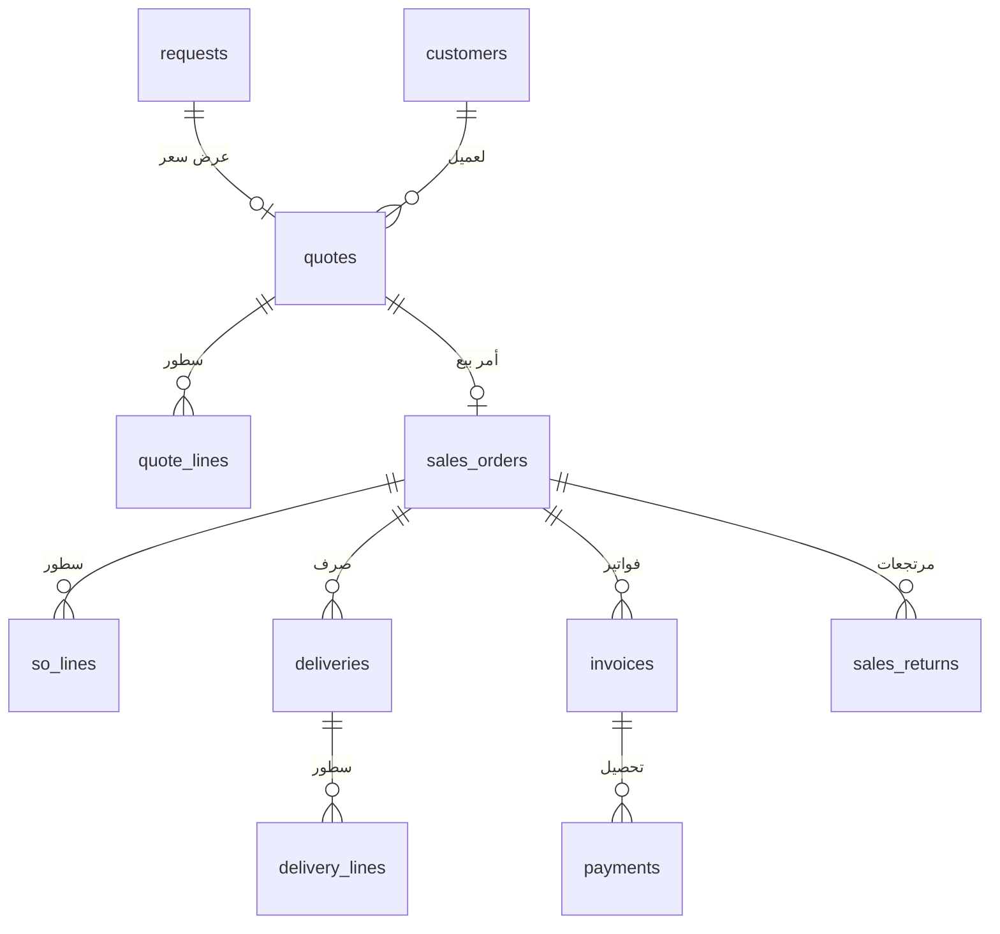
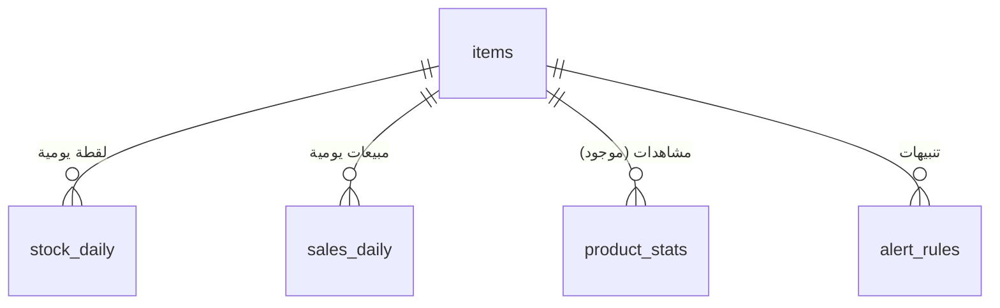

# نظام المخازن وتحليل البيانات — التصميم الكامل

> **الحالة:** تصميم مُقترَح، لم يُنفَّذ بعد. هذا الملف هو المرجع الذي تُبنى منه
> جداول القاعدة شاشةً شاشة، ويُعدَّل كلما تغيّر القرار.
>
> آخر تعديل: 2026-10-16

---

## 1. الخلاصة

المتجر يبقى كما هو أمام الزائر: كتالوج بلا أسعار، وزرّ «اطلب» يفتح النموذج
الموجود فيصل الطلب للمبيعات. **لا سعر يظهر للعميل، ولا بوابة دفع.**

والنظام الحقيقي يُبنى **خلف اللوحة**: مخازن وأرصدة وتكلفة واصلة وتقارير. وهو
ما تفعله أمازون فعلًا — واجهتها البسيطة ليست سرّها، سرّها ما تحت: تعرف في كل
لحظة ما لديها، وبكم جاءها، وكم يُطلب منها وليس عندها.

---

## 2. خمسة مبادئ يقوم عليها التصميم

### 2.1 دفتر الحركة هو مصدر الحقيقة، لا الرصيد

`stock_moves` دفتر لا يُعدَّل ولا يُحذف منه: كل استلام وصرف وتحويل وجرد سطر
جديد فيه. و`stock.qty` ليس حقيقةً مستقلّة بل **حاصل جمع الدفتر**، يُحفظ لأن
جمع ملايين السطور في كل شاشة بطيء.

ولهذا سببٌ عملي: حين يختلف الرصيد عن الواقع — وسيختلف — يُفتَح الدفتر فيُعرف
متى ومن ولماذا. والنظام الذي يحفظ رقمًا واحدًا ويعدّله لا يملك جوابًا.

> **القاعدة:** لا شاشة ولا سكربت يكتب في `stock.qty` مباشرةً. الكتابة في
> الدفتر، والرصيد يُعاد حسابه.

### 2.2 صنف المخزن غير منتج الموقع

`products` اليوم للتسويق: اسم وصورة ووصف وصفحة. والمخزن يحتاج ما لا يظهر على
الموقع: زيوت وفلاتر ومسامير وعُدَد. والعكس: معدة واحدة على الموقع قد تكون ثلاثة
أصناف في المخزن (الهيكل، المحرك، الطقم).

فـ`items` جدول مستقلّ، يرتبط بـ`products` حين يكون للصنف صفحة، ويبقى بلا ارتباط
حين لا يكون. دمجهما يُفسد الاثنين.

### 2.3 التكلفة الواصلة لا ثمن الفاتورة

أنتم مستوردون. القطعة التي ثمنها 100 دولار تكلّفكم 100 + نولون + جمارك + تأمين
+ تخليص + نقل داخلي. ومن يحسب هامشه على ثمن الفاتورة وحده **يظنّ أنه يربح وهو
يخسر**.

فمصاريف الشحنة تُسجَّل في `shipment_costs` وتُوزَّع على أصناف الشحنة — بالقيمة
أو بالوزن — ثم تدخل في `item_costs.avg_cost`. وكل تقرير ربح بعدها رقمٌ صادق.

### 2.4 السعر داخليّ

`price_lists` موجودة للتقارير وعروض السعر، **لا تُقرأ من أي شاشة يراها زائر**.
قائمة للتجزئة وأخرى للجملة وثالثة لعميل بعقد، ولكل منها تاريخ سريان.

### 2.5 ما يُطلب ولا يوجد أهمّ ممّا يوجد

أقوى ما في أمازون أنها تعرف الطلب الذي لم تلبّه. وعندكم نصفه جاهز:
`search_stats` يسجّل ما يبحث عنه الزوّار، و`product_stats` ما يُشاهَد،
و`requests` ما يُطلب. وصل هذه بالمخزون يعطي سؤالًا لا يُجيبه أي نظام محاسبي:
**«ما الذي طُلب منّا هذا الشهر ولم يكن لدينا؟»**

---

## 3. الخريطة العامة



---

## 4. ① الأصناف



### `items` — الصنف المخزني

| العمود | النوع | الشرح |
|---|---|---|
| `id` | int PK | |
| `sku` | varchar(60) **unique** | رقم الصنف. هو ما يبحث به العميل ويُنطق في التليفون |
| `name_ar` / `name_en` | varchar(255) | |
| `brand_id` | FK → brands | |
| `product_id` | FK → products **nullable** | صفحته على الموقع إن وُجدت |
| `kind` | enum | `machine` معدة · `part` قطعة · `consumable` مستهلك · `tool` عُدّة |
| `uom` | varchar(20) | وحدة القياس: قطعة · لتر · متر · طقم |
| `is_serialized` | bool | المعدات نعم (لكلٍّ رقم تسلسلي)، القطع لا |
| `has_lots` | bool | الزيوت والفلاتر لها تشغيلة وصلاحية |
| `reorder_point` | decimal | عنده يُنبَّه المخزن |
| `reorder_qty` | decimal | الكمية المقترحة للطلب |
| `lead_time_days` | int | مدة التوريد المعتادة — تُحسب تلقائيًا من أوامر الشراء |
| `weight_kg` / `volume_m3` | decimal | لتوزيع مصاريف الشحن بالوزن |
| `hs_code` | varchar(20) | البند الجمركي — يختصر التخليص |
| `status` | enum | `active` · `discontinued` · `draft` |
| `created_at` / `updated_at` | ts | |

### `item_fitments` — «بتركب على إيه»

| العمود | النوع | الشرح |
|---|---|---|
| `item_id` | FK → items | القطعة |
| `product_id` | FK → products | المعدة التي تناسبها |
| `note_ar` / `note_en` | varchar(255) | «من سنة 2019 فأحدث» مثلًا |

> أكثر سؤال يصل المبيعات بالتليفون. وتسجيله هنا يجعل البوت وصفحة المنتج
> يجيبان عنه بلا تدخّل بشري.

### `item_barcodes`
`item_id` · `barcode` (unique) · `kind` (`ean` · `supplier` · `internal`)

### `item_suppliers`
`item_id` · `supplier_id` · `supplier_sku` · `last_cost` · `currency` · `lead_time_days` · `is_preferred`

---

## 5. ② المخازن



### `warehouses`
`id` · `code` · `name_ar/en` · `address` · `city` · `is_active`

### `locations` — الأرفف
`id` · `warehouse_id` · `code` (مثل `A-03-02`) · `kind` (`shelf` · `floor` · `quarantine` حجر للتالف · `transit`)

> حتى لو عندكم مخزن واحد بلا أرفف: يُنشأ موقع واحد `MAIN`. البنية تبقى، فإن
> كبرتم لا يُعاد بناء شيء.

### `stock` — الرصيد (مشتقّ، للقراءة السريعة)
`item_id` · `location_id` · `qty_on_hand` · `qty_reserved` · `updated_at`
— مفتاح فريد `(item_id, location_id)`
— **المتاح للبيع = `qty_on_hand - qty_reserved`**

### `stock_moves` — دفتر الحركة ⭐

| العمود | النوع | الشرح |
|---|---|---|
| `id` | bigint PK | |
| `item_id` | FK | |
| `from_location_id` / `to_location_id` | FK nullable | أحدهما فارغ في الاستلام أو الصرف |
| `qty` | decimal | موجب دائمًا؛ الاتجاه من الموقعين |
| `kind` | enum | `receipt` استلام · `issue` صرف · `transfer` تحويل · `adjust` تسوية جرد · `return_in` مرتجع عميل · `return_out` مرتجع لمورد · `scrap` إتلاف |
| `ref_type` / `ref_id` | varchar/int | المستند: `receipt` · `delivery` · `stock_count` · `sales_return` |
| `lot_id` / `serial_id` | FK nullable | |
| `unit_cost` | decimal | التكلفة الواصلة وقت الحركة — تُجمَّد هنا فلا يغيّرها تغيّر الأسعار لاحقًا |
| `user_id` | FK → users | من فعلها |
| `note` | varchar(255) | |
| `at` | timestamp | |

> **لا `UPDATE` ولا `DELETE` على هذا الجدول.** الخطأ يُصحَّح بحركة عكسية،
> كما في دفاتر المحاسبة. فيبقى التاريخ كما جرى لا كما نتمنّى.

### `lots` — التشغيلة والصلاحية
`id` · `item_id` · `lot_no` · `expires_on` · `received_at`

### `serials` — الأرقام التسلسلية
`id` · `item_id` · `serial` (unique) · `status` (`in_stock` · `sold` · `with_customer`) · `location_id` · `sold_to_customer_id` · `warranty_until`

> المعدة المباعة تبقى معروفة: لمن ذهبت، ومتى ينتهي ضمانها. وهذا وحده يصنع
> خدمة ما بعد البيع.

### `stock_counts` + `stock_count_lines` — الجرد
`stock_counts`: `id` · `warehouse_id` · `status` (`open` · `counting` · `closed`) · `started_at` · `closed_at` · `user_id`
`stock_count_lines`: `count_id` · `item_id` · `location_id` · `system_qty` · `counted_qty` · `diff` · `note`

> إقفال الجرد يولّد حركات `adjust` بالفروق. فلا يُعدَّل رصيد بيد أحد.

---

## 6. ③ الشراء والاستيراد



### `suppliers`
`id` · `name` · `country` · `currency` · `contact_name` · `phone` · `email` · `lead_time_days` · `payment_terms` · `notes` · `is_active`

### `purchase_orders`
`id` · `number` · `supplier_id` · `status` (`draft` · `sent` · `confirmed` · `partial` · `received` · `cancelled`) · `currency` · `fx_rate` · `ordered_at` · `eta` · `incoterm` (FOB/CIF/EXW) · `created_by` · `notes`

### `po_lines`
`po_id` · `item_id` · `qty` · `unit_cost` · `received_qty`

### `shipments` — الشحنة والتخليص
`id` · `po_id` · `bl_no` بوليصة الشحن · `carrier` · `etd` · `eta` · `arrived_at` · `cleared_at` · `status`

### `shipment_costs` — مصاريف الشحنة ⭐
`id` · `shipment_id` · `kind` (`freight` نولون · `customs` جمارك · `insurance` تأمين · `clearance` تخليص · `inland` نقل داخلي · `other`) · `amount` · `currency` · `fx_rate` · `allocation` (`by_value` بالقيمة · `by_weight` بالوزن · `by_qty` بالكمية)

> هذا الجدول هو الفرق بين «بعنا بربح 20%» و«بعنا بخسارة 3%».

### `receipts` + `receipt_lines`
`receipts`: `id` · `shipment_id` · `po_id` · `warehouse_id` · `received_at` · `user_id`
`receipt_lines`: `receipt_id` · `item_id` · `qty` · `location_id` · `lot_id` · `serial_id` · `landed_unit_cost`

> الاستلام يولّد حركات `receipt` في الدفتر ويحدّث `item_costs`.

---

## 7. ④ التكلفة والتسعير (داخليّ)



### `item_costs`
`item_id` PK · `avg_cost` المتوسط المرجّح الواصل · `last_cost` · `currency` · `method` (`wavg` · `fifo`) · `updated_at`

### `price_lists`
`id` · `name_ar/en` (تجزئة · جملة · عقد الشركة الفلانية) · `currency` · `is_active` · `valid_from` · `valid_to`

### `price_list_items`
`price_list_id` · `item_id` · `price` · `min_qty` · `valid_from` · `valid_to`

### `customer_price_lists`
`customer_id` · `price_list_id` · `valid_from` · `valid_to`

---

## 8. ⑤ البيع — من النموذج إلى الفاتورة



المسار كاملًا:

```
زائر يضغط «اطلب»  →  requests (النموذج الموجود، بلا تغيير)
                   →  quote    عرض سعر يكتبه المبيعات بأسعار داخلية
                   →  sales_order  لمّا العميل يوافق (يحجز الكمية)
                   →  delivery إذن صرف (يخصم من المخزن فعليًّا)
                   →  invoice + payments
```

### `quotes`
`id` · `number` · `request_id` nullable · `customer_id` · `status` (`draft` · `sent` · `accepted` · `rejected` · `expired`) · `currency` · `valid_until` · `subtotal` · `discount` · `tax` · `total` · `created_by` · `sent_at`

### `quote_lines`
`quote_id` · `item_id` · `qty` · `unit_price` · **`unit_cost_at_time`** · `discount` · `line_total`

> تجميد التكلفة في السطر يجعل تقرير الهامش صحيحًا بعد سنة، مهما تغيّرت
> الأسعار. وبدونه يتغيّر ربح العام الماضي كلما وصلت شحنة جديدة.

### `sales_orders`
`id` · `number` · `quote_id` · `customer_id` · `status` (`confirmed` · `reserved` · `partial` · `delivered` · `cancelled`) · `ordered_at` · `required_at` · `total`

### `so_lines`
`so_id` · `item_id` · `qty` · `unit_price` · `reserved_qty` · `delivered_qty`

> التأكيد يزيد `stock.qty_reserved` — فلا يُباع ما هو محجوز لعميل آخر. وهذه
> الخانة وحدها تمنع أكثر مشاكل المخازن إحراجًا.

### `deliveries` + `delivery_lines`
`deliveries`: `id` · `number` · `so_id` · `warehouse_id` · `delivered_at` · `driver` · `vehicle` · `received_by` · `user_id`
`delivery_lines`: `delivery_id` · `item_id` · `qty` · `location_id` · `lot_id` · `serial_id`

### `invoices` + `invoice_lines` + `payments`
`invoices`: `id` · `number` · `so_id` · `customer_id` · `issued_at` · `due_at` · `subtotal` · `tax` (14%) · `total` · `status` (`unpaid` · `partial` · `paid` · `void`)
`payments`: `id` · `invoice_id` · `amount` · `method` (`cash` · `transfer` · `cheque`) · `paid_at` · `ref` · `user_id`

> تسجيل تحصيل، لا بوابة دفع. المبلغ يُكتب بعد وصوله.

### `sales_returns` + `sales_return_lines`
`id` · `so_id` · `customer_id` · `reason` · `status` · `returned_at` — وسطوره تولّد حركات `return_in`.

---

## 9. ⑥ التحليل



### `stock_daily` — لقطة يومية
`day` · `item_id` · `warehouse_id` · `qty` · `value` (الكمية × التكلفة الواصلة)

> بدونها لا يمكن رسم «قيمة المخزون خلال السنة» إلا بإعادة جمع الدفتر كلّه في
> كل مرة — وهو ما يُبطئ الشاشة حتى تُهجَر.

### `sales_daily`
`day` · `item_id` · `qty` · `revenue` · `cost` · `margin`

### `alert_rules`
`id` · `kind` (`low_stock` · `dead_stock` · `expiring` · `po_overdue` · `demand_gap`) · `params` json · `channel` (`dashboard` · `email` · `whatsapp`) · `is_active`
— التنبيه نفسه يذهب إلى جدول `notifications` الموجود.

### الموجود فعلًا ويُوصَل بهذا
`product_stats` (مشاهدات وطلبات) · `search_stats` (ما يُبحث عنه) · `traffic_daily` · `visitors_daily` · `requests` · `deals`

---

## 10. التقارير التي يصير النظام قادرًا عليها

**المخزن**
1. قيمة المخزون الآن، وتطوّرها شهرًا بشهر
2. معدّل الدوران لكل صنف — ما يتحرّك وما يرقد
3. **المخزون الراكد:** ما لم يتحرّك 180 يومًا وقيمته كذا ← فلوس نائمة على رفّ
4. ما اقترب من نقطة إعادة الطلب، والكمية المقترحة
5. ما قاربت صلاحيته على الانتهاء
6. دقّة الجرد: فروق كل جرد ومن أين تأتي

**الربح**
7. هامش كل صنف بالتكلفة الواصلة لا بثمن الفاتورة
8. هامش كل عميل، وكل ماركة، وكل مندوب
9. أثر سعر الصرف: كم كلّفنا ارتفاع الدولار هذا الربع

**الطلب**
10. **الطلب غير الملبّى:** ما طُلب أو بُحث عنه ولم يكن عندنا ← قائمة الشراء القادمة
11. الأكثر طلبًا مقابل الأكثر مشاهدة — ما يُشاهَد ولا يُطلب فيه مشكلة سعر أو وصف
12. موسمية الطلب: أي الشهور يرتفع فيها أي صنف

**الموردون**
13. التزام كل مورّد بموعده (الفرق بين `eta` و`arrived_at`)
14. تطوّر أسعار كل مورّد

---

## 11. الخطة

| المرحلة | المحتوى | المدة | يُسلَّم شغّالًا |
|---|---|---|---|
| **0 · الأساس** | `items` · `warehouses` · `locations` · `stock` · `stock_moves` · شاشة الأصناف · الجرد الافتتاحي | ~أسبوع | تعرف ما عندك وأين |
| **1 · الحركة** | استلام · صرف · تحويل · جرد · باركود من الموبايل | ~أسبوع | المخزن يتحرّك بالنظام لا بالورق |
| **2 · الشراء** | `suppliers` · `purchase_orders` · `shipments` · **التكلفة الواصلة** · `item_costs` | ~أسبوعان | تعرف تكلفتك الحقيقية |
| **3 · البيع** | `quotes` من النموذج · `sales_orders` + الحجز · `deliveries` · `invoices` | ~أسبوعان | من الطلب إلى الفاتورة بلا إكسل |
| **4 · التحليل** | `stock_daily` · `sales_daily` · لوحة التقارير الـ14 | ~أسبوع | القرار برقم لا بظنّ |
| **5 · الأتمتة** | تنبيهات النفاد والركود والصلاحية · اقتراح أمر شراء · ربط البحث بالمخزون · البوت يعرف المتاح | ~أسبوع | النظام ينبّهك قبل ما تسأل |

**الإجمالي: 7–8 أسابيع**، وكل مرحلة تُسلَّم شغّالة وحدها.

### ترتيب البدء المقترح
المرحلة 0 ثم 2. السبب: معرفة ما عندك وبكم جاءك هما أكبر وجع فعليّ، والبيع
يسير اليوم بالتليفون والإكسل ولا يتعطّل انتظارًا للنظام.

---

## 12. ما يحتاج قرارًا منك قبل التنفيذ

1. **المخازن:** مخزن واحد أم أكثر؟ وهل فيه أرفف مرقّمة أم كومة واحدة؟
2. **العملة:** الشراء بالدولار والبيع بالجنيه — نثبّت سعر الصرف وقت الشحنة أم نحدّثه؟
3. **التكلفة:** متوسط مرجّح (أبسط وأشيع) أم FIFO؟
4. **الأرقام التسلسلية:** هل تتابعون أرقام المعدات المباعة اليوم؟
5. **البداية:** جرد افتتاحي كامل، أم ندخل الأصناف تدريجيًّا مع أول حركة لكلٍّ؟
